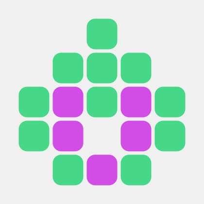
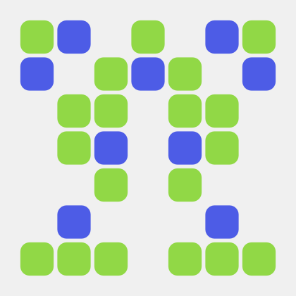
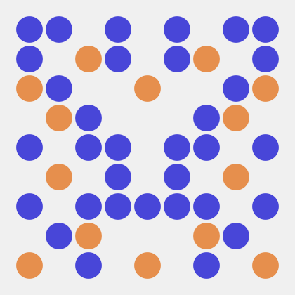
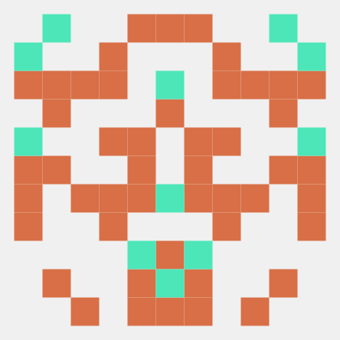
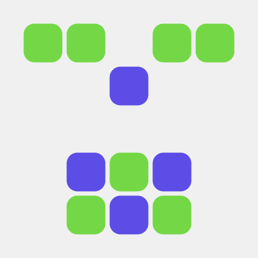
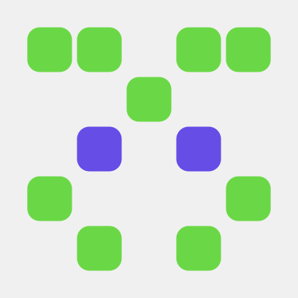

# m-avatars

**One melody, many instruments.** Deterministic, symmetric pixel avatars from any name. The same face comes out of Python, Go, and JavaScript, down to the byte.

<p>
  
  
  
  
  
  
</p>

> 📖 **Read the story:** [Separate the Melody from the Instrument](blog.md). It uses a nursery rhyme to teach one of the most important ideas in software, for anyone aged 8 to 80.

## Quick start

No dependencies. Each implementation is a single file.

```sh
python3 identicon.py captain-pixel
go run identicon.go captain-pixel
node identicon.mjs captain-pixel
```

```text
    ██
  ██████
██▒▒██▒▒██
██▒▒  ▒▒██
  ██▒▒██
```

Render an SVG or get the raw sheet as JSON:

```sh
python3 identicon.py --format svg --size 9 --shape circle "your name" > avatar.svg
node identicon.mjs --format json captain-pixel
# {"size":5,"palette":[[0,0,94],[147,65,56],[292,75,60]],"grid":["00100","01110","12121","12021","01210"]}
```

| Option | Default | Meaning |
|---|---|---|
| `--size` | `5` | grid width and height, 1 to 64 |
| `--density` | `52` | percent chance each cell is filled, 0 to 100 |
| `--format` | `text` | `text`, `svg`, or `json` |
| `--shape` | `rounded` | SVG pixel shape: `square`, `rounded`, `circle` |
| `--check FILE` | | verify against golden vectors and exit |

Go uses single-dash flags (`-size 9`), and flags must come before the seed.

## How it's built: three lanes

Every implementation is split into the same three sections, and code never crosses between them:

| Lane | Job | Allowed | Not allowed |
|---|---|---|---|
| **1 · Melody** | `compose(seed, size, density) → sheet` | integer math | I/O, locale, Unicode helpers, formatting |
| **2 · Instrument** | `render_*(sheet) → text / SVG / JSON` | drawing | randomness, any choice that changes the sheet |
| **3 · Stage** | CLI, files, stdout | input checks, I/O | algorithm logic |

The melody is FNV-1a over ASCII-normalized UTF-8 bytes, then xorshift32, then a mirrored grid fill. The precise rules are in [`SPEC.md`](SPEC.md). **The spec is the source of truth; the code just performs it.**

## Parity

[`golden.json`](golden.json) has 17 vectors aimed at the places where implementations usually drift: Unicode case folding (`İlkay`, `ΟΔΥΣΣΕΑΣ`), `trim()` disagreements (BOM, `\x1c`), multi-byte UTF-8, empty seeds, 1×1 grids, even and odd sizes, and a seed (`z-n7paa'`) whose hash is exactly zero.

```sh
make check
# python: 17/17 vectors match m-avatars/1
# go: 17/17 vectors match m-avatars/1
# js: 17/17 vectors match m-avatars/1
```

CI runs the same check on every push. Each binary also replays the `captain-pixel` handshake at startup and refuses to run if it doesn't match.

## Add an instrument

To port m-avatars to Rust, Swift, Kotlin, Lua, or anything else:

1. Implement `compose` from [`SPEC.md`](SPEC.md), **not** by translating another port. Don't use your language's `lower()` or `trim()`.
2. Add a `--check golden.json` mode and get it to pass all 17 vectors.
3. Add it to the `check` target in the [`Makefile`](Makefile) and to [CI](.github/workflows/parity.yml).

Renderers are yours to invent: PNG, terminal colors, CSS grid, LEGO bricks. If a change alters any golden vector, it's a new spec version, not a refactor.

## Files

| File | What it is |
|---|---|
| [`SPEC.md`](SPEC.md) | the score: the algorithm, byte by byte |
| [`golden.json`](golden.json) | the contract: 17 test vectors |
| [`identicon.py`](identicon.py), [`identicon.go`](identicon.go), [`identicon.mjs`](identicon.mjs) | three performances |
| [`blog.md`](blog.md) | why it's built this way |
| [`gallery/`](gallery) | sample avatars and the blog's illustrations (`make gallery`) |

## License

[MIT](LICENSE)
