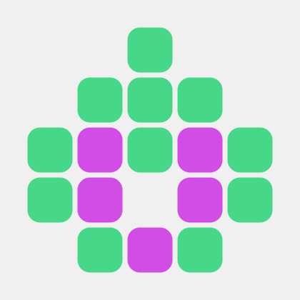
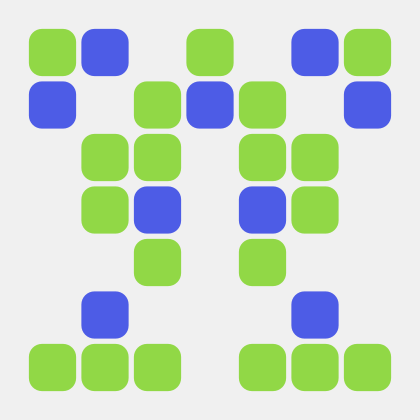
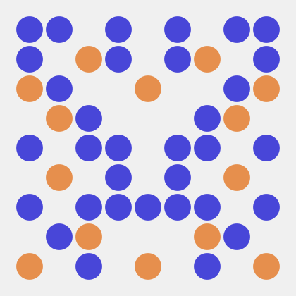
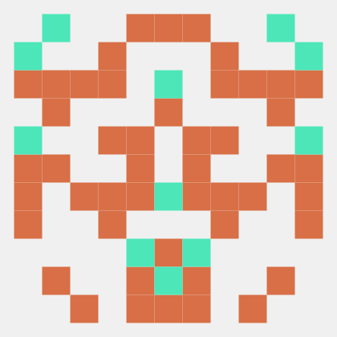
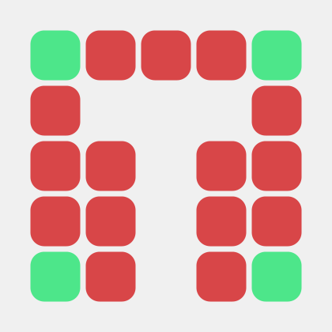
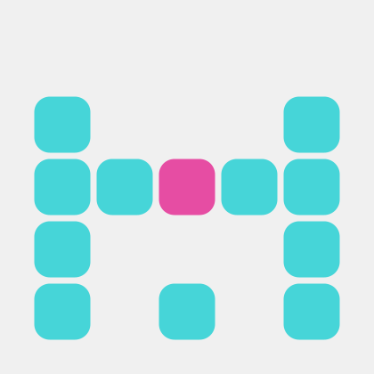
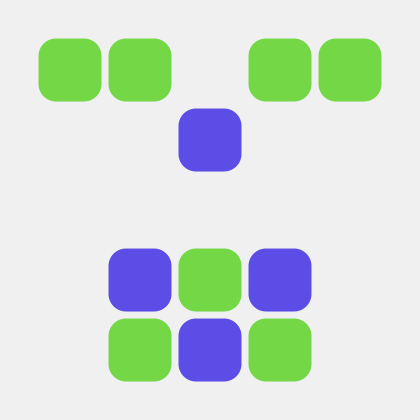

# Separate the Melody from the Instrument

*What a nursery rhyme can teach anyone, aged 8 to 80, about building software that lasts*

---

## 1. Hum this

**E – D – C – D – E – E – E**

You heard it, right? *Mary Had a Little Lamb.*

Quick question: **what instrument did you hear it on?**

Maybe a piano. Maybe a recorder from music class. Maybe no instrument at all, just a voice in your head. It doesn't matter, because the song is the same on all of them.

Next question: **what happens to the song when the recorder breaks?**

Nothing. You pick up something else and play it again. The song lives in seven letters on paper, and the instrument is just how you happen to hear it today.

Hold on to that idea:

> **The melody is not the instrument.**

That's the whole lesson. The rest of this post shows why it matters just as much in software, and what happens when you forget it.

---

## 2. What goes wrong: gluing the song to the instrument

Let's build something. It's an **avatar maker**: you type a name and get a little pixel face back.

<p>
  
  
  
  
</p>

There's one rule: **the same name must always get the same face.** `captain-pixel` gets this exact face today, tomorrow, and on every device, because it's someone's identity.

The quick way to build it is one big script that does everything at once. It picks random numbers, chooses colors, draws squares, and saves a picture file. It works on your laptop.

Then a friend asks: *"Can my phone app show the same faces?"* The phone app is written in a different programming language, and your website uses a third one.

So look back at the script. **Where is the "song"?** Where's the part that decides what `captain-pixel` looks like?

It's tangled up with the drawing code and the file saving. You can't hand it to the phone. You'd have to rebuild the whole thing, and hope you rebuild it *exactly* the same.

That's what gluing the melody to the instrument looks like.

---

## 3. The fix: three jobs, three lanes

Split the work the way a band does:

| Lane | Band role | Its one job | It must never... |
|---|---|---|---|
| **1 · Melody** | the composer | decide every note | touch a screen, a file, or the outside world |
| **2 · Instrument** | the musician | play the notes it's given | change a note |
| **3 · Stage** | the crew | deal with the outside world: which name, where to save | write music |

Between lanes you pass **plain data**, like sheet music. It's paper with numbers on it that anyone can read. It isn't a gadget, a file, or a special object that only one language understands.

```text
   "captain-pixel"
         │
   ┌─────▼──────┐   sheet music    ┌──────────────┐   picture   ┌─────────┐
   │   MELODY   │ ───────────────► │  INSTRUMENT  │ ──────────► │  STAGE  │
   │  decides   │  (just numbers)  │    plays     │             │  saves  │
   └────────────┘                  └──────────────┘             └─────────┘
```

---

## 4. What does sheet music for a face look like?

It's graph paper with only three numbers:

- `0` means empty
- `1` means main color
- `2` means sparkle color

Here's the sheet music for `captain-pixel`:

```text
0 0 1 0 0
0 1 1 1 0
1 2 1 2 1
1 2 0 2 1
0 1 2 1 0
```

That's the whole song: 25 digits, plus three colors written as numbers.

How does a name turn into this? The melody uses three simple tricks:

1. **The Letter Blender.** It mixes the letters of the name into one big number. The same name always blends to the same number.
2. **The Spinner.** It spins that number like a board-game spinner to get an endless stream of "random" numbers. The stream is exactly the same every time you start from the same number.
3. **Folded Paper.** It paints dots on the left half of the grid, then folds the paper so the right half matches. That symmetry is why random dots end up looking like faces.

<sub>Grown-up names, if you want them: FNV-1a hash, xorshift32 random number generator, mirrored grid fill. The full recipe is in [`SPEC.md`](SPEC.md).</sub>

Now look at what is **not** in the melody. There are no pixels, no image files, and no screen. It's only counting. That's why it can go anywhere.

---

## 5. Same song, different instruments

Hand that sheet music to three different instruments:

<p>
  
  
  
</p>

Rounded squares, sharp squares, and circles. **Is it the same face?**

Yes. The shape changed but the song didn't. You can play it in a terminal too:

```text
    ██
  ██████
██▒▒██▒▒██
██▒▒  ▒▒██
  ██▒▒██
```

This repo plays the melody in **three programming languages**: Python, Go, and JavaScript. Ask all three to draw `captain-pixel` and you get the same picture file, down to the last character.

So we're done, right? The melody is pure counting. **What could possibly go wrong?**

---

## 6. The plot twist: when the musicians disagreed

My first version had two languages, Go and Python. Each one checked `captain-pixel` when it started up, and both gave the same face, so I declared victory.

Then I typed a Turkish name: **İlkay** (note the dot on the capital I).

<p>
  
  &nbsp;&nbsp;
  
</p>

*Left: what Go drew. Right: what Python drew. Same name, same recipe, two different faces.*

Before reading on, **guess which one is wrong.**

Here's the answer: **neither one.** That's why this kind of bug is so sneaky.

### What happened?

The recipe had one small step at the start: *"make the name lowercase first,"* so that `CAPTAIN-PIXEL` and `captain-pixel` get the same face. That sounds harmless.

Each language has a built-in "make lowercase" button, so I used it. But lowercasing isn't counting. It's a **language rule**, and different languages follow different rules:

- What's the lowercase version of **İ**? Go says plain **i**.
- Python says **i** with an extra invisible dot mark attached, which is *two* characters.

Both answers are reasonable. But the Letter Blender received different letters, blended them into a different number, and drew a different face.

### Put it back in music terms

Imagine the sheet music said *"play this part softly"* without saying how soft. The pianist plays it one way and the recorder player plays it another. Nobody broke a rule. **The score left a blank, and each musician filled it in their own way.**

That one word, `lowercase`, let the **instrument** sneak into the **melody's lane**. A decision that belonged to the composer got quietly handed to whichever language happened to be playing.

### Why didn't my check catch it?

I only tested `captain-pixel`, which uses plain English letters. Every language already agrees on those. It's like checking whether a choir is in tune by asking everyone to sing the one note they all know.

---

## 7. The fix: write the note down exactly

The fix was not to make Python copy Go. That would just crown one musician as the boss, and every future musician would have to imitate it.

Instead, I **wrote the rule down so precisely that nobody has to guess.** The recipe, [`SPEC.md`](SPEC.md), now says:

> Only change the letters `A` to `Z` into `a` to `z`. Leave everything else exactly as it is.

That takes three lines in any language. Nothing is borrowed and nobody's opinion is involved. Now **İlkay** gets one face, everywhere:

<p></p>

That's the most important idea in this post:

> **The code is a performance. The spec is the score.**
>
> When two performances disagree, you don't argue about which musician is better. You check the score. And if the score doesn't say, the score is what you fix.

---

## 8. How do you know everyone plays it right? Test the hard notes

One test name wasn't enough, so the repo now has [`golden.json`](golden.json): **17 names with known answers.** Every language must match all 17.

The trick is choosing *which* 17. They aren't easy ones. They're the notes where musicians are most likely to disagree:

- names with special letters, like **İlkay**, **ΟΔΥΣΣΕΑΣ** (Odysseus in Greek), and **Straße 🦙**
- names with invisible characters hidden at the start or end
- an empty name, and a tiny 1×1 face
- **`z-n7paa'`**, a nonsense name that blends to exactly **zero**. The recipe has a special rule for zero, so I searched for a name that triggers it. Without that name, that rule had never been tested.

```text
$ make check
python: 17/17 vectors match m-avatars/1
go: 17/17 vectors match m-avatars/1
js: 17/17 vectors match m-avatars/1
```

> **Test where musicians might disagree, not where you already know they agree.**

---

## 9. What AI changes, and what it doesn't

Programmers have an old rule: **DRY**, short for *Don't Repeat Yourself.* Writing the same logic in two languages meant twice the chances for mistakes.

AI can now translate code between languages in seconds. So is the rule dead?

No. **It moved.** You can repeat the *typing* as often as you like, but you should never repeat the *decisions*. The decisions live in one place, the score, and every language just performs it.

There's a catch. If I had asked an AI to translate my first Python version into JavaScript, it would have used JavaScript's own lowercase button, which is the natural, idiomatic choice. That would have added a *third* opinion about **İlkay**.

AI is a brilliant session musician. It plays fast and fills every blank with its own taste. So **give it the score, not a recording, and test it on the hard notes.** The JavaScript version in this repo was built from `SPEC.md` and `golden.json` and passed all 17 on its first run.

---

## 10. Try it yourself

```sh
python3 identicon.py "your name"
```

Now try two experiments, and **predict before you run them:**

1. Add `--format svg --shape circle` and save the output to a file. **Does the face change?**
2. Instead, add `--density 80`. **Does the face change?**

<details>
<summary>Answers</summary>

1. **No.** You swapped the *instrument*. Circles or squares, it's the same song.
2. **Yes.** Density is an input to the *melody*, so you wrote a different song.

If you can explain *why* those two answers differ, you understand this whole post.
</details>

---

## The stay-in-your-lane checklist

Use this for the next thing you build, whether it's a game, a website, a pricing rule, or a science project:

1. **What's the melody?** List the decisions. If they don't fit on an index card, you have more than one melody.
2. **What's the sheet music?** Make the handoff between deciding and drawing plain data that anyone could read.
3. **Which "buttons" are you borrowing?** Lowercase, trim, round, sort, random, dates and times: each one is an instrument with its own opinions. Either write down exactly what you want, or keep it out of the melody.
4. **Where would two musicians disagree?** Put your tests there.
5. **Did a note change?** Then it's a new version of the song, so give it a new version number.

---

Instruments break. Languages go out of style. AI models get faster every month. The plastic xylophone always cracks.

Don't glue your idea to the xylophone. Write down **E – D – C – D – E – E – E**, clearly enough that anyone, or any robot, can play it without asking you what you meant.

*Everything is in this repo: the score ([`SPEC.md`](SPEC.md)), the hard notes ([`golden.json`](golden.json)), and three performances ([`identicon.py`](identicon.py), [`identicon.go`](identicon.go), [`identicon.mjs`](identicon.mjs)). Run `make check` to hear them all play.*
